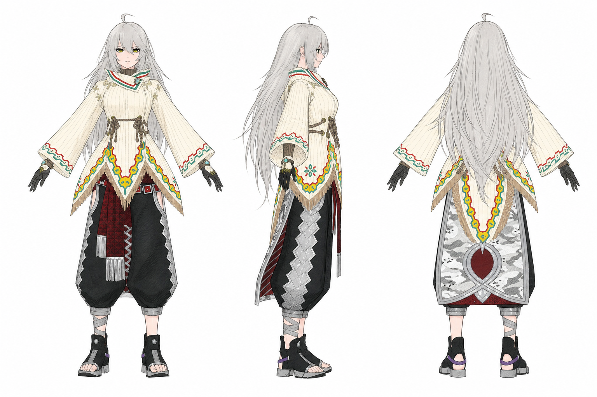
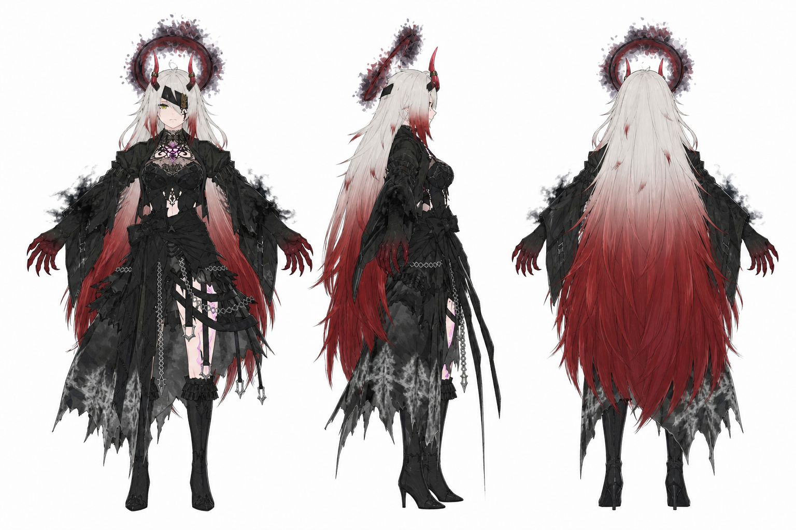

# ヴィオラ

> 一言で：神に「災厄の魔女」の運命を決めつけられ、その神を殺しにいく16歳の少女。

## 基本情報
| 項目 | 内容 | 状態 |
| --- | --- | --- |
| 名前（読み） | ヴィオラ | 【確定】 |
| 性別 | 女性 | 【確定】 |
| 年齢（外見年齢） | 16歳 | 【確定】 |
| 出身・所属 | ワルプルギスの辺境の村。ただし村生まれではなく、捨て子を拾われて育った | 【確定】 |
| 立ち位置 | 主人公 | 【確定】 |
| 初登場・加入・離脱・復帰 | 序章から最後まで | 【確定】 |

## 外見
ユーザーが生成した三面図（2026-11-27）による。【確定】

### 村娘のとき

- 髪：銀白色のロングヘア。太ももに届くほど長い。アホ毛があり、顔の横に細い三つ編みが一本ある。
- 目：金色（黄色）の瞳。表情はむすっとした仏頂面。
- 上衣：クリーム色のリブ編みのチュニック。袖は大きく広がる。襟は赤と緑の縞の折り返しで、裾と袖口に赤・緑・黄色のジグザグや菱形の民族風の刺繍がある。裾は三角に切れこみ、房飾りがついている。腰を茶色の紐で結ぶ。下に焦げ茶のタートルネックを着ている。
- 手：黒い手袋。手首にターコイズの石の飾り。
- 下衣：黒いゆったりしたズボンに、銀色のギザギザの縁取り。前に赤い織物の帯（房つき）を垂らす。背面は灰色のまだら模様の布で、赤い輪の紋章がある。
- 足：ふくらはぎに灰色の布を巻き、黒い厚底のサンダルを履く。
- 印象：辺境の狩人らしい、素朴な民族衣装。

### 魔女になった後

- 頭：赤い角が二本生える。頭の後ろに、黒と赤の煙でできた崩れかけの光輪が浮かぶ。
- 髪：銀白色から毛先にかけて深紅へ変わるグラデーション。村娘のときよりさらに長く、量も多い。
- 目：右目を黒い眼帯（金の紋様入り）で覆う。見えている左目は金色のまま。
- 服：黒いゴシック調のドレス。胸元はレースで、首元に紫の宝石。大きな袖は破れていて、黒い煙のような闇がまとわりつく。スカートは左右で長さがちがい、ぼろぼろに裂けた裾に灰と白の霜のような模様がある。腰から鎖と、短剣のような飾りが垂れる。
- 手：黒から赤へ変わる鉤爪の手。
- 足：左の太ももに、ピンクから紫に光る紋様が見える。黒いハイヒールのロングブーツで、上端にフリル。
- 印象：堕ちた天使と鬼を混ぜたような姿。村娘のときと同じ銀髪と金の瞳が残っていて、同一人物だと分かる。

## 性格
- 表の顔：男勝りでサバサバしている。「女だからって舐めてんじゃないわよ」と言うタイプ。【確定】
- 裏の顔：未定。
- パーティ内の役回り：ツッコミ。キロスとボケとツッコミのコンビになる。【有力】
- 口調・一人称・二人称：未定。
- 口癖・決め台詞：グローリアへの煽り「虫も殺しませんって顔。清廉潔白ですって顔がムカつく。どうせ男も知らないでしょ、処女め」【確定（台詞メモ）】

## 能力・戦い方
- 力の源：アークスレベルでフォトンを扱える（裏設定）。村焼きで災厄の魔女（ダークファルスもどき）として目覚める。【確定】
- 武器・戦闘スタイル：身体能力がとにかく高い。狩りで猪を素手で捕まえ、すごい速度で走る。【確定】武器は未定。
- 得意・苦手：未定。
- 罪の刻印がなく、神の管理の外にいる。闇に落ちても最後まで自分の意思を保つ。【確定】

## 過去・背景
オディーニアが災厄の魔女の素体として置き去りにした子で、刻印がないのも神の仕業である。【確定】辺境の村に拾われて育った。村は古いしきたりに支配された因習村だった。【有力】

序章で、ヴィオラが狩りで村を離れている間に、村が異端としてヴァルキュリアに襲撃される（村焼き）。村人はおそらく全員殺される。【確定】

## 物語での役割
- 抱えている問題：神への復讐。異端狩りで、しきたりに染まっていない子供まで殺されたことだけは許せない。【確定】
- 神との関わり：神から見るとイレギュラー寄り。魔女の素体として置いたのは計画どおりだが、神に刃を向けるのは想定外で、神は計画を切り替えた。【確定】
- 見せ場の章と山場：1章で幼なじみを自分の手で殺し、復讐の覚悟を決める。【確定】
- 結末：神を殺し、最初で唯一の眷属キロスに殺される。【確定】キロスが殺す理由は未定（神が力を押しつけて勝ち逃げを狙い、次の神にならないうちにキロスが終わらせる案あり）。【案】

## 人間関係
| 相手 | 関係 | 一言 |
| --- | --- | --- |
| 幼なじみ（名前未定） | 幼なじみ。1章ボス | 同情はできるが、子供まで巻き込んだことは許せない【確定】 |
| キロス | 唯一の眷属。ヒロイン | 偶然生かした相手に、最後は終わらせてもらう【確定】 |
| グローリア | 宿敵 | 神に一番近い女と、神に一番遠い女【案】 |

## 台詞サンプル
- 「女だからって舐めてんじゃないわよ」
- 「あんたの神様、あんたが負けるの待ってんのよ」【案】

## 未決点・メモ
- 口調、武器、裏の顔。
- 魔女姿の右目の眼帯の下に何があるか（失明か、闇の紋様か）。
- 魔女姿の太ももの光る紋様は、罪の刻印（ヴィオラにはない）とどう区別するか。
- キロスがヴィオラを殺す理由。
